# Week 2

1. Buat kode tersebut seperti tampilan awal:
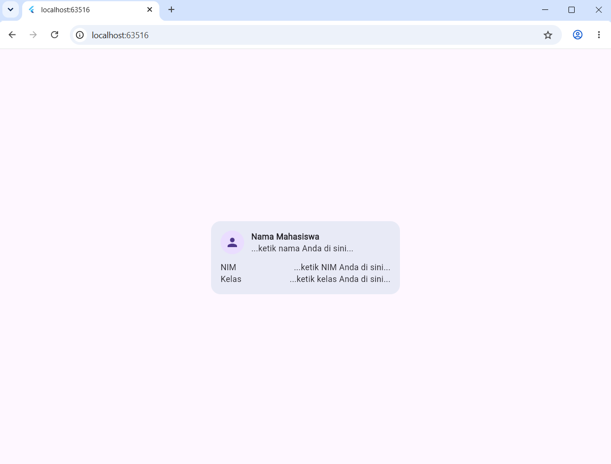
2. Tambahkan kode untuk memasukkan nama, NIM, dan informasi lainnya:
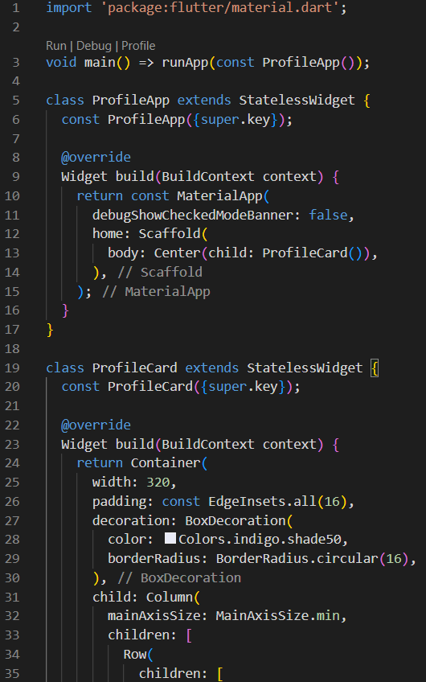
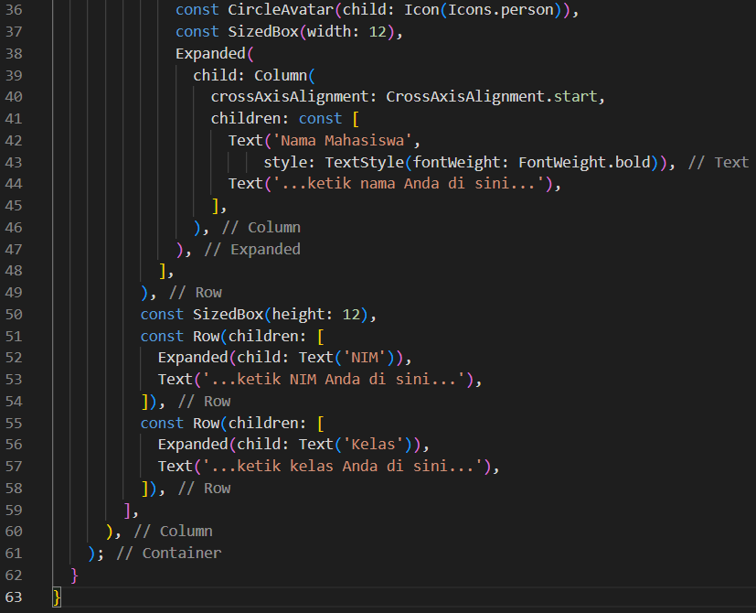
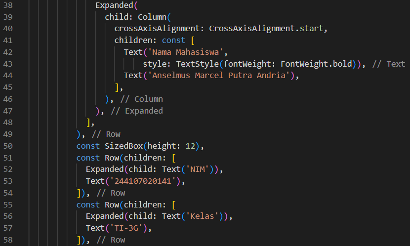
Sehingga hasilnya seperti ini:
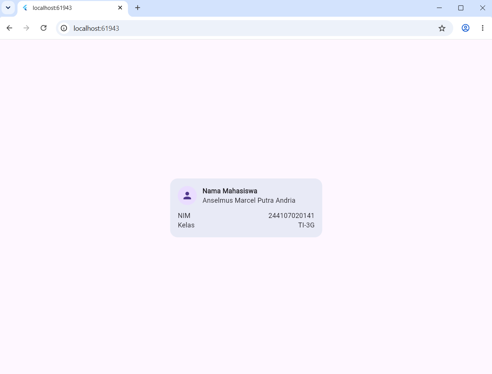
3. Jika ```expanded``` dihapus, nothing changes (?)
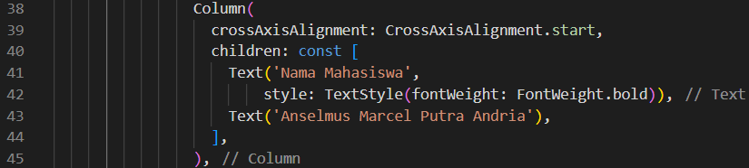
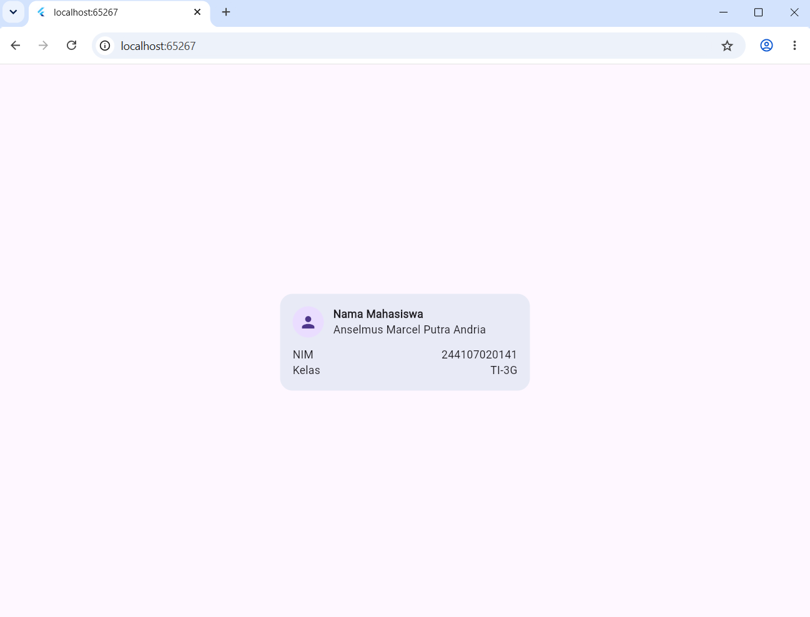
4. Jika ```mainAxisSize: MainAxisSize.min``` menjadi default (max), hasilnya akan menjadi mentok dari atas sampai bawah:
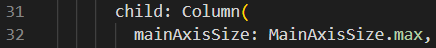
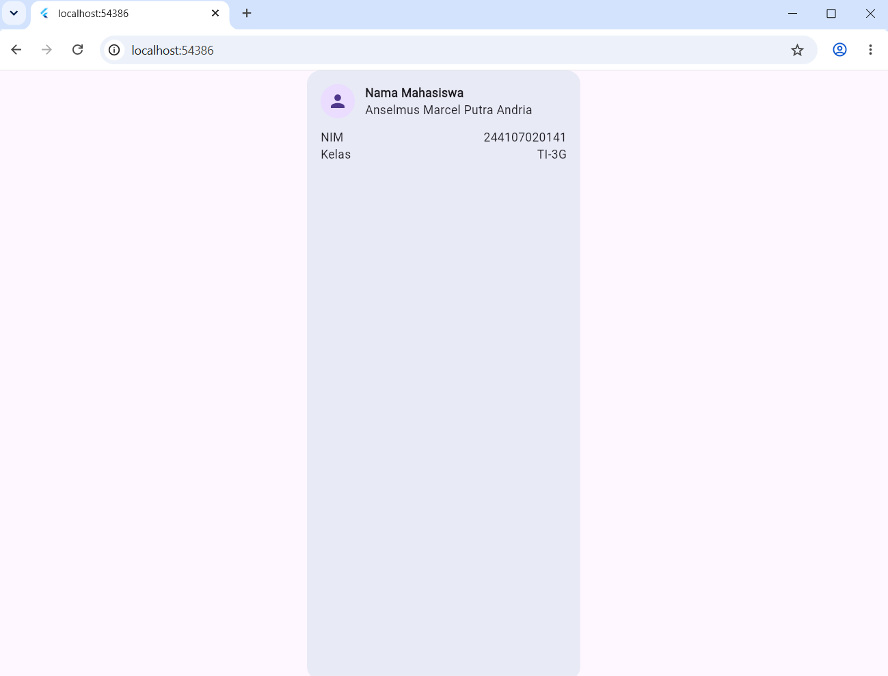
5. Berikut adalah kode dan tampilan jika menambahkan kolom email tersebut:
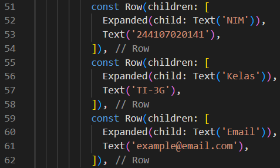
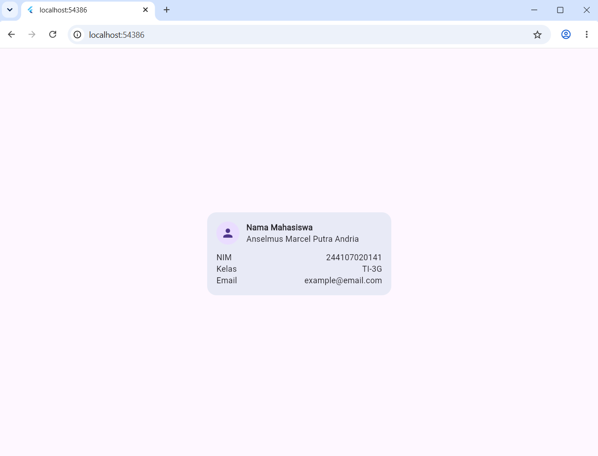
6. Buat proyek baru bernama responsive_dashboard.
7. Ketik kode tersebut hingga tampilannya seperti ini:
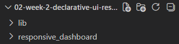
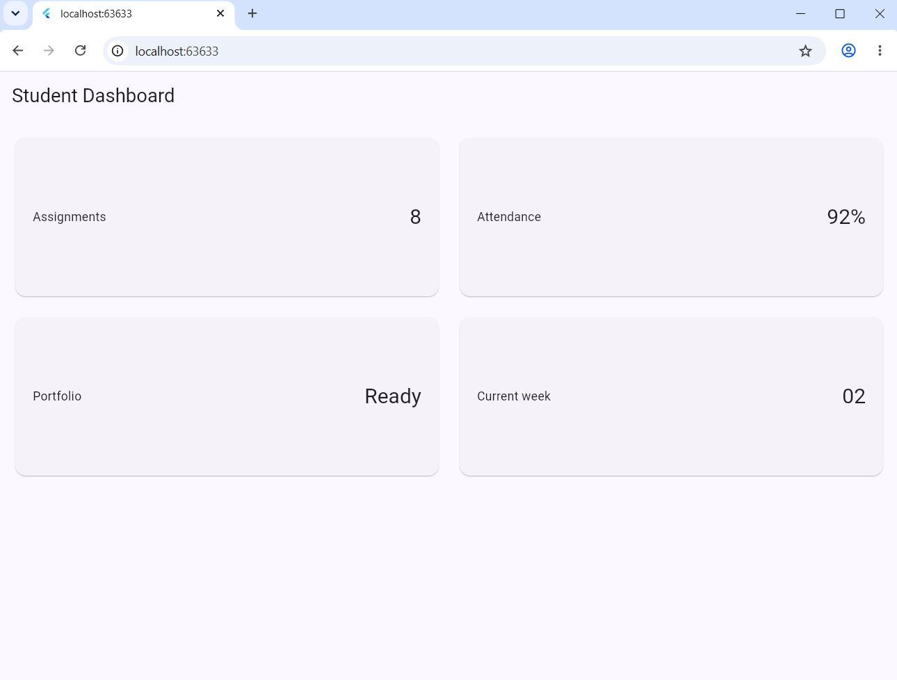
8. Yang terjadi jika mengubah breakpoint dari 700 menjadi nilai lain (misalnya, 1600):
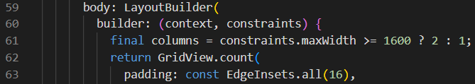
Tampilan tersebut berubah menjadi 1 kolom daripada 2 kolom jika width &lt; 1600.
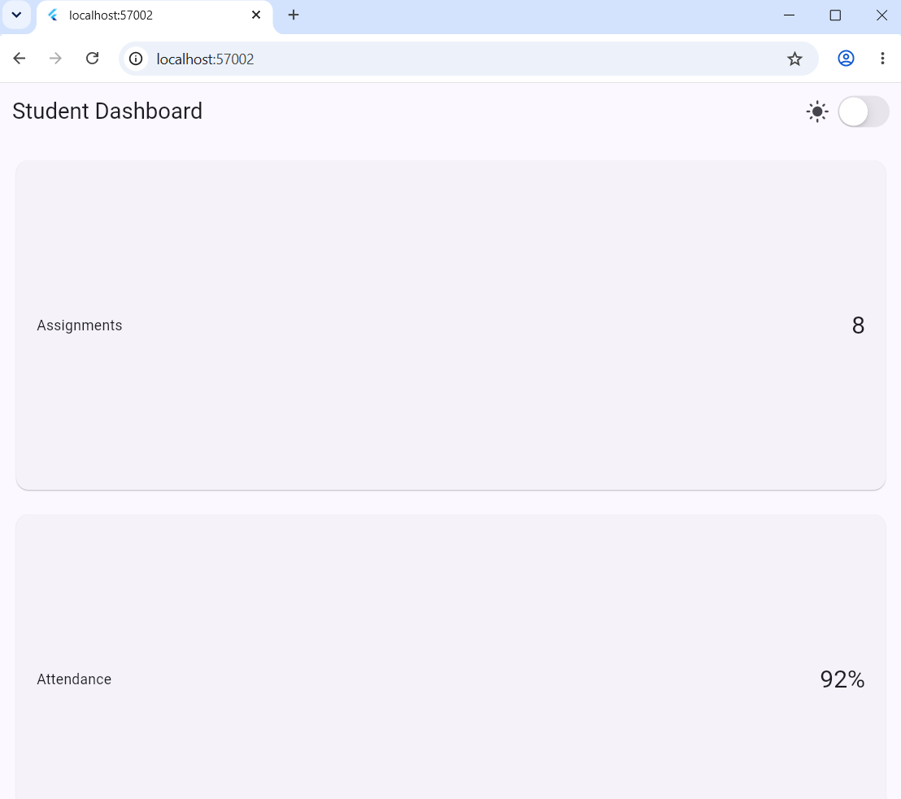
9. Tambahkan kode untuk menambahkan toggle tema gelap:
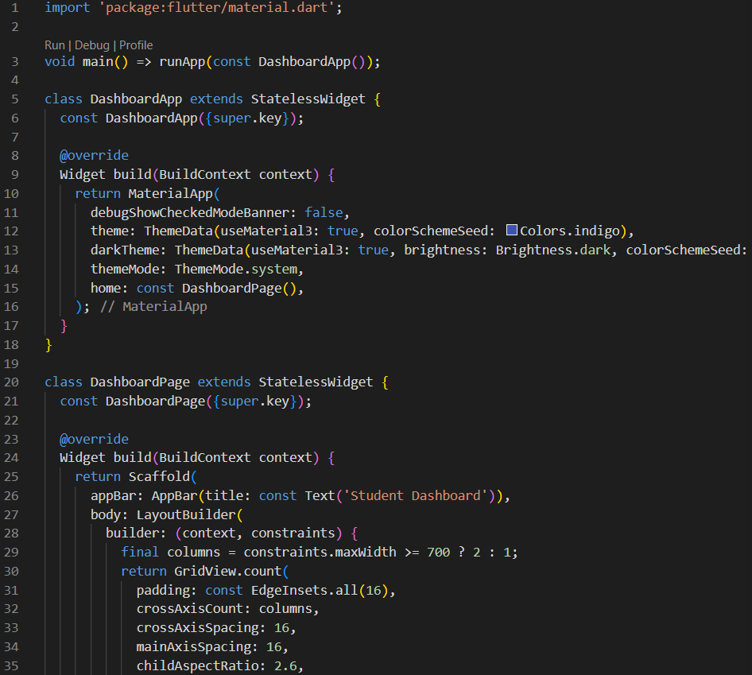
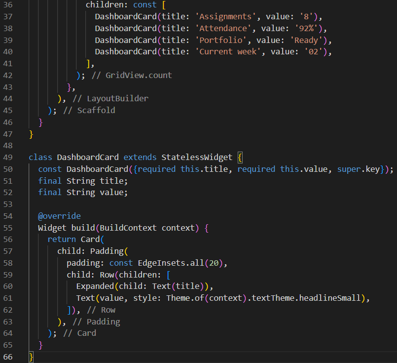
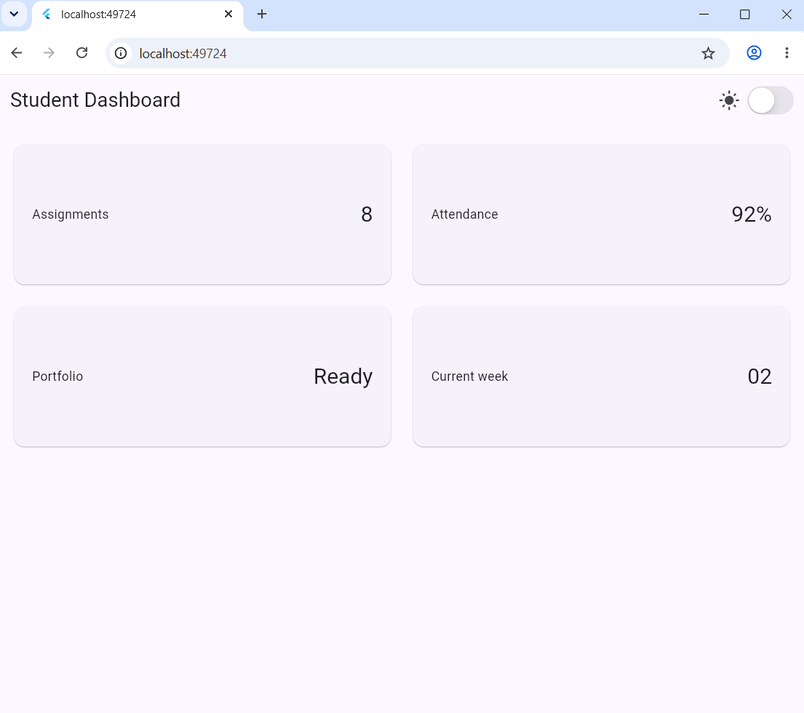
10. Berikut tampilan untuk tema gelap:
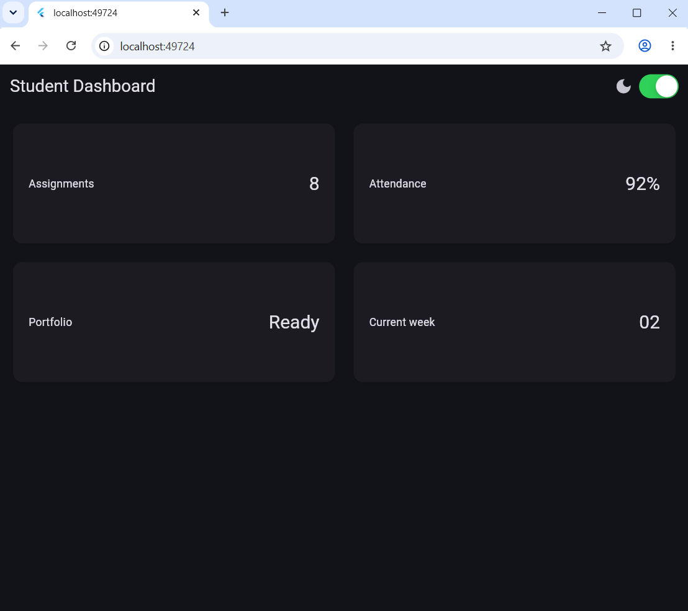