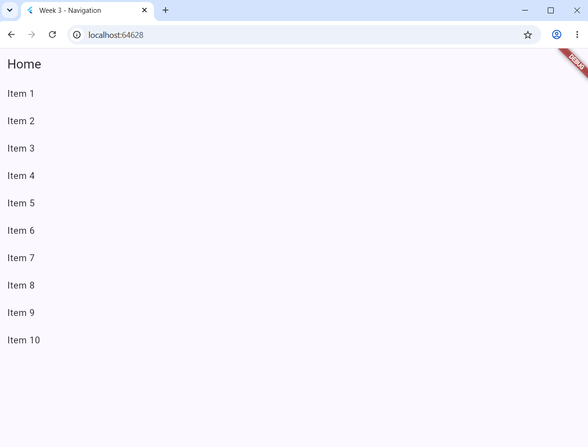
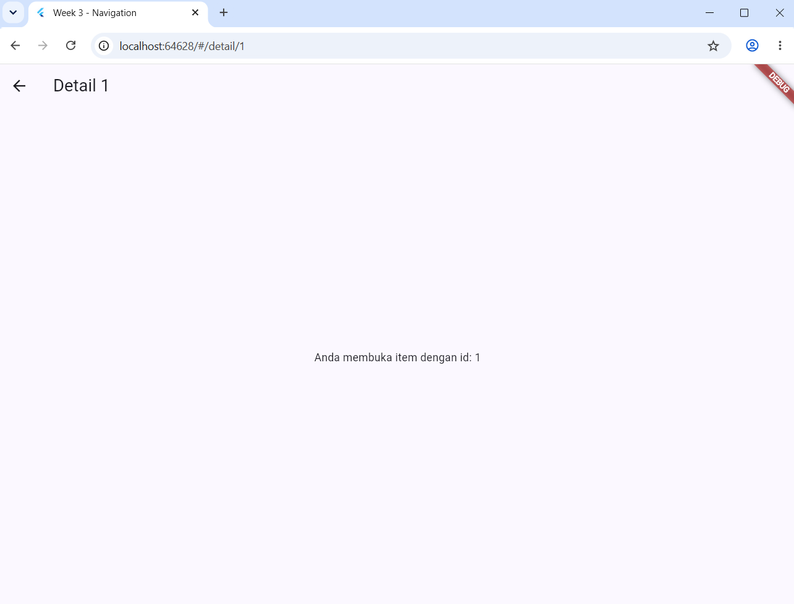
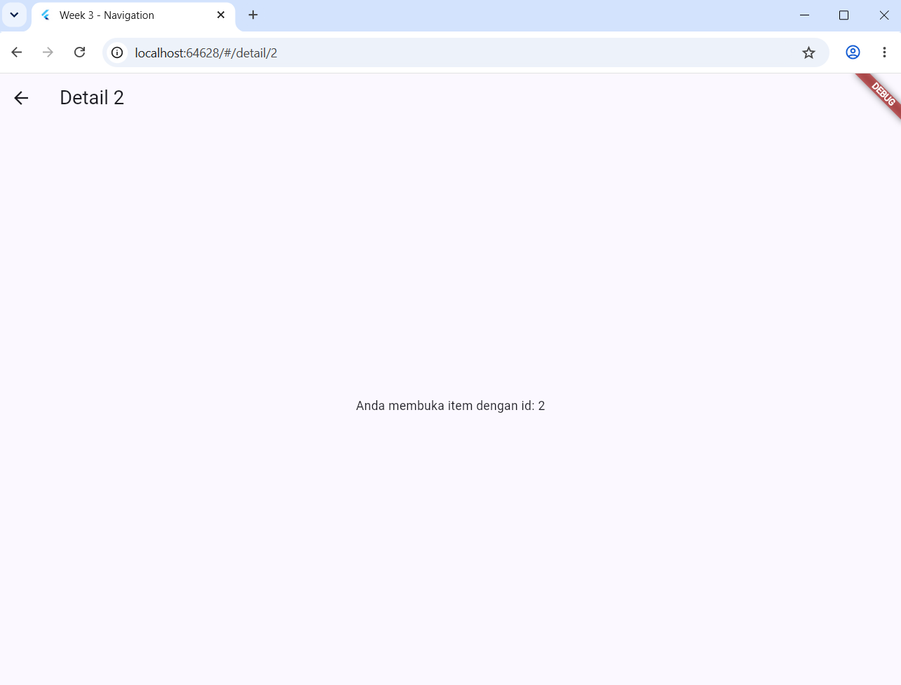
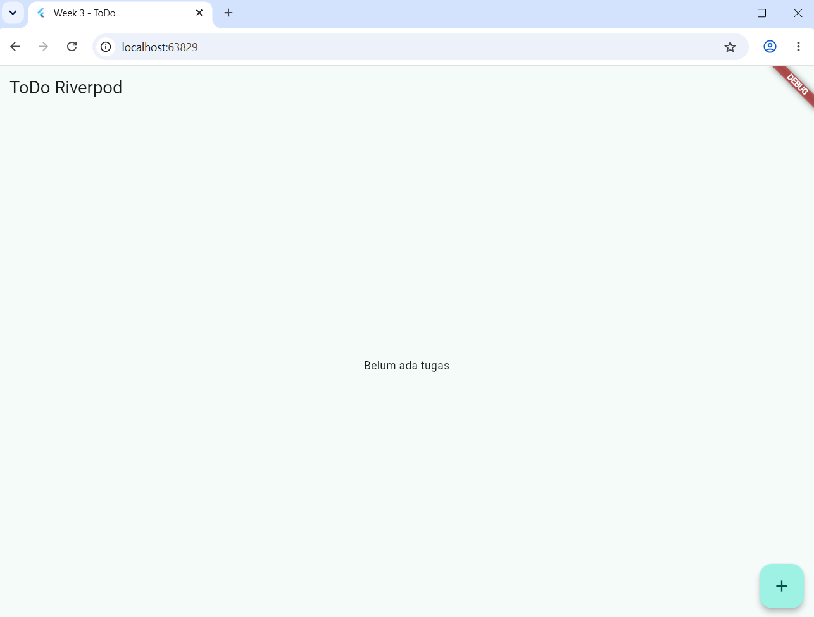
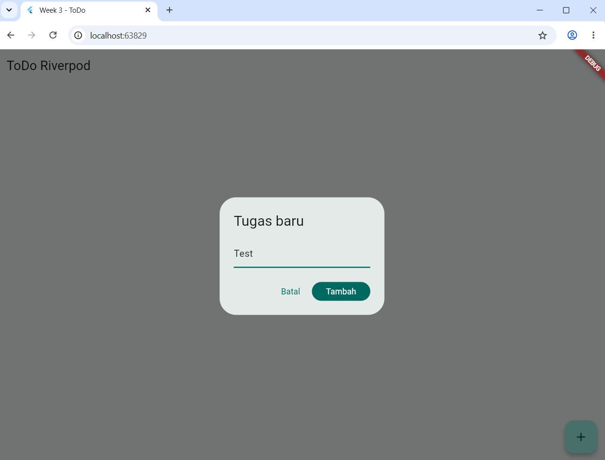
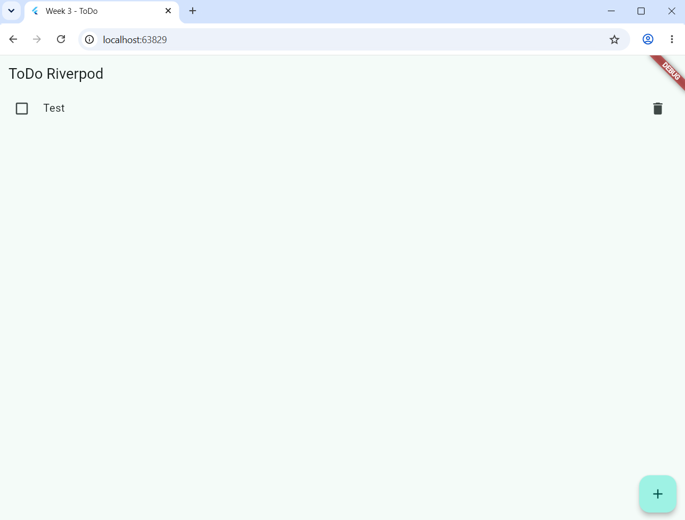
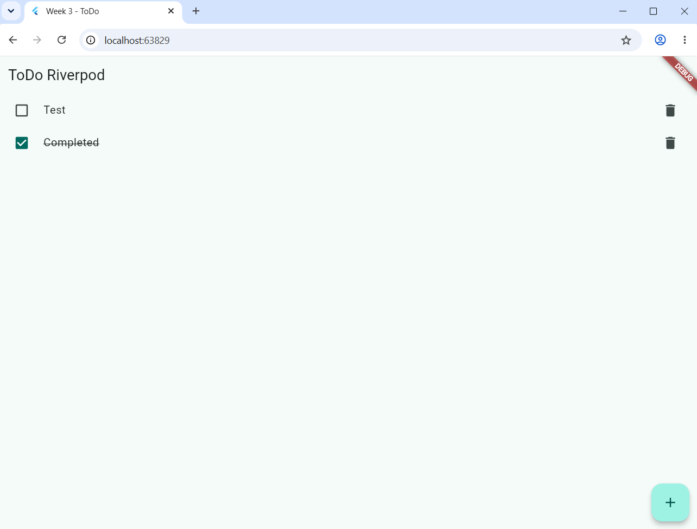

# Week 3

1. Buat proyek baru bernama week3_navigation.
2. Buat kode tersebut hingga tampilannya seperti ini:

3. Klik salah satu pada list tersebut (misal, item 1), maka, ini tampilannya:

4. Berikut juga pada item 2:

5. Buat proyek baru bernama week3_todo.
6. Buat kode tersebut hingga tampilannya seperti ini:

7. Tambahkan list tersebut...

...sehingga muncul listnya seperti ini:

8. Centang box pada list tersebut, yang berarti task tersebut telah selesai:
