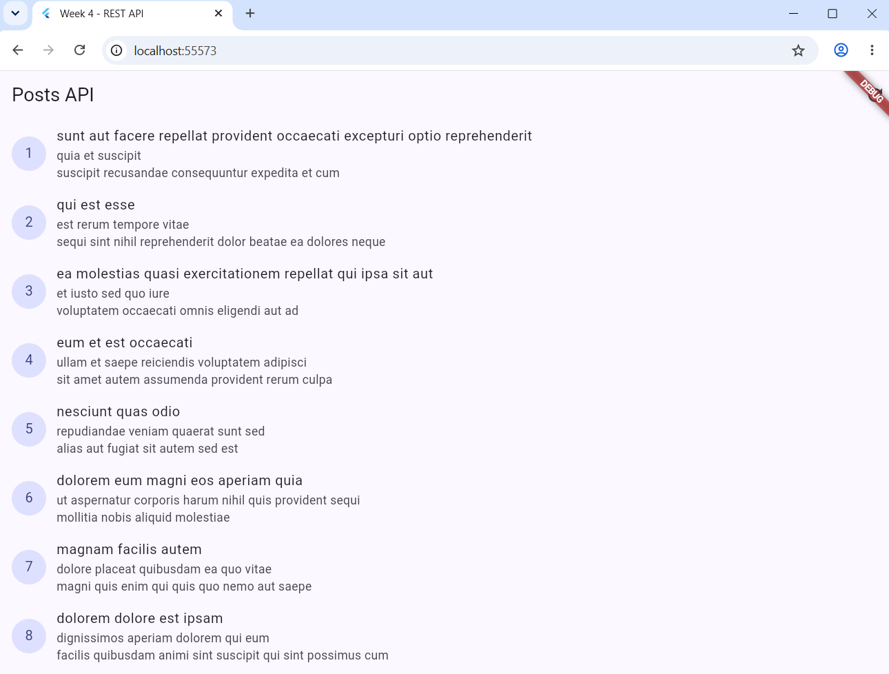
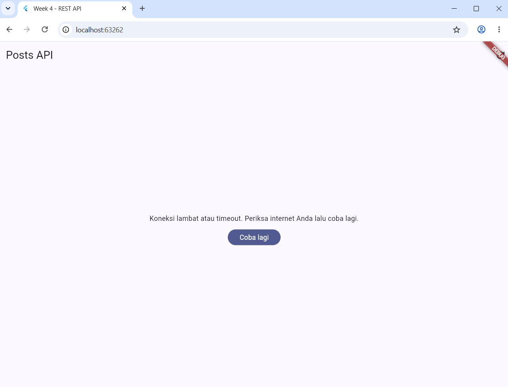
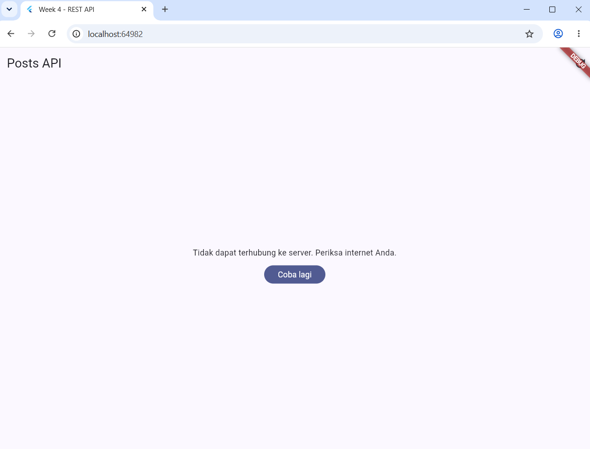
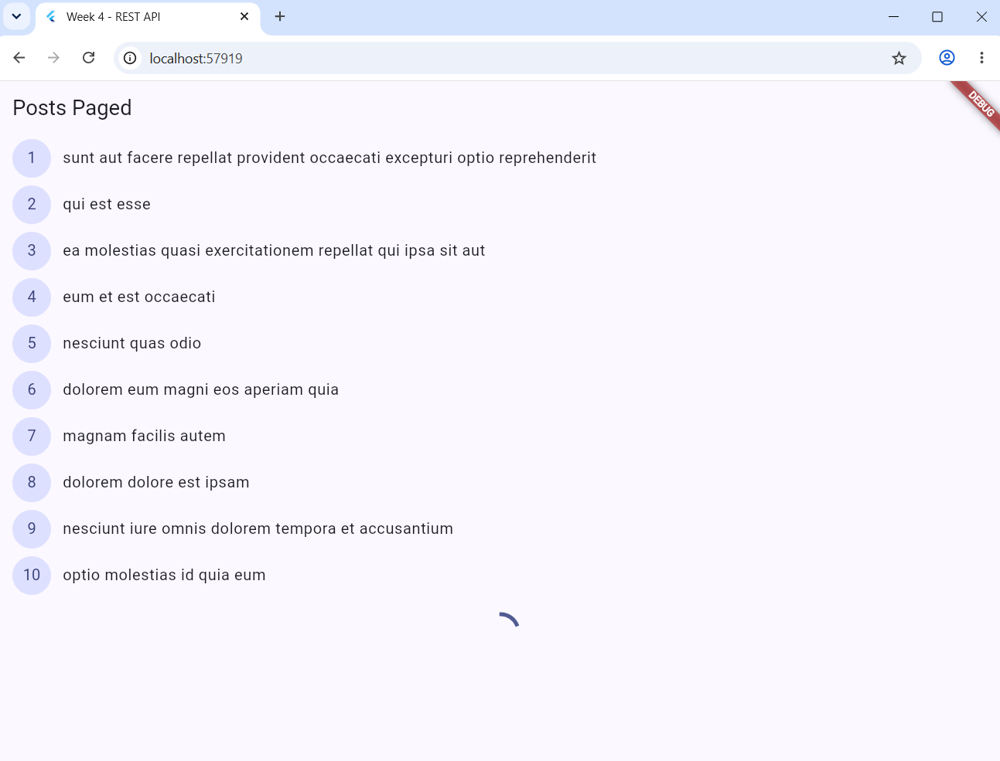
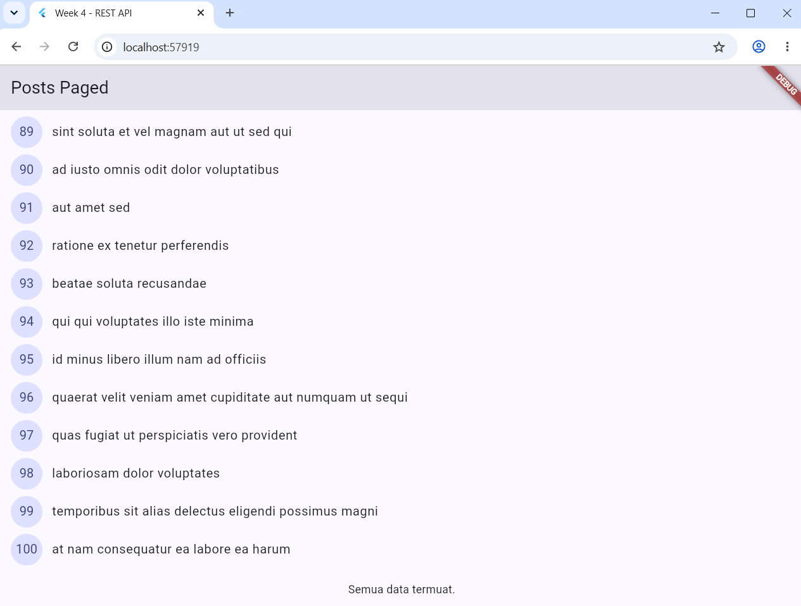

# Week 3

1. Buat proyek baru bernama week4_api.
2. Buat kode tersebut hingga tampilannya seperti ini:

3. Putuskan internetnya, refresh, tunggu 10 detik sehingga tampilannya error seperti ini:

4. Setelah itu, sambungkan lagi internetnya sehingga bisa muncul tampilan awalnya.
5. Ganti baseUrl menjadi URL salah, tunggu 10 detik sehingga tampilannya error seperti ini:

6. Kembalikan URL yang telah digantikan tersebut.
7. Untuk pagination, ketik kode sehingga tampilannya seperti ini:

8. Melihat bahwa list ini akan memuat tiap 10 baris.
9. Scroll terus sampai mentok ke bawah:
